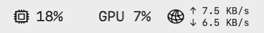
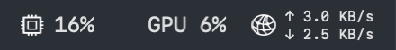
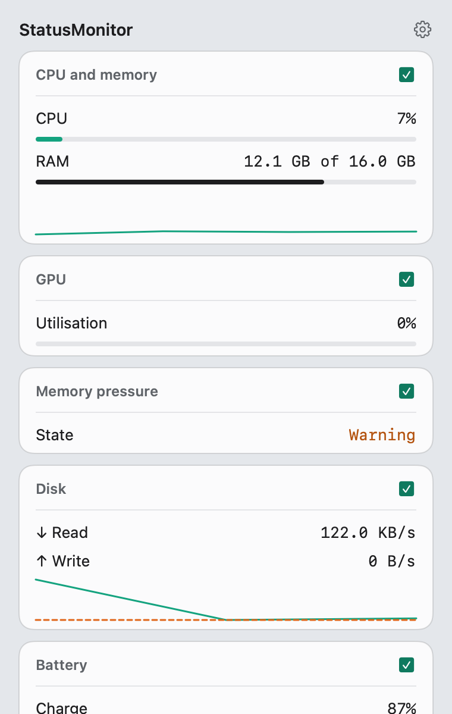
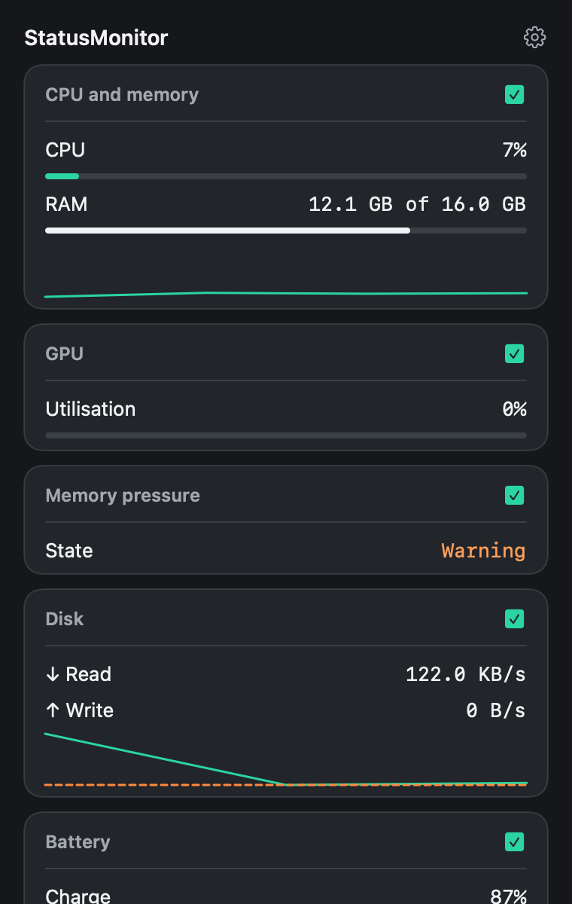
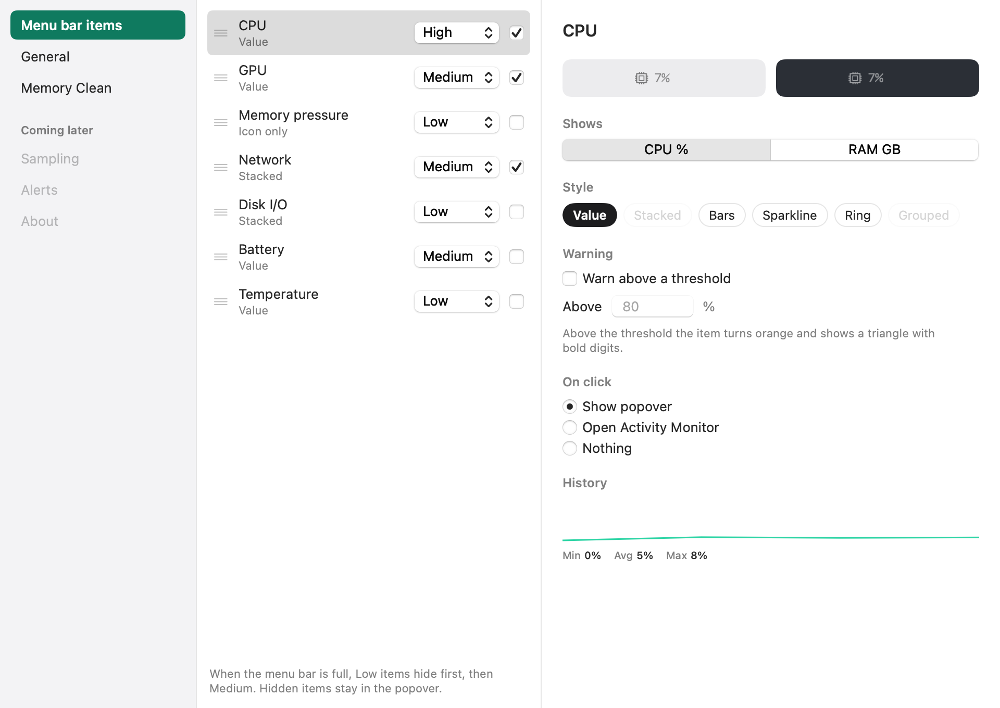
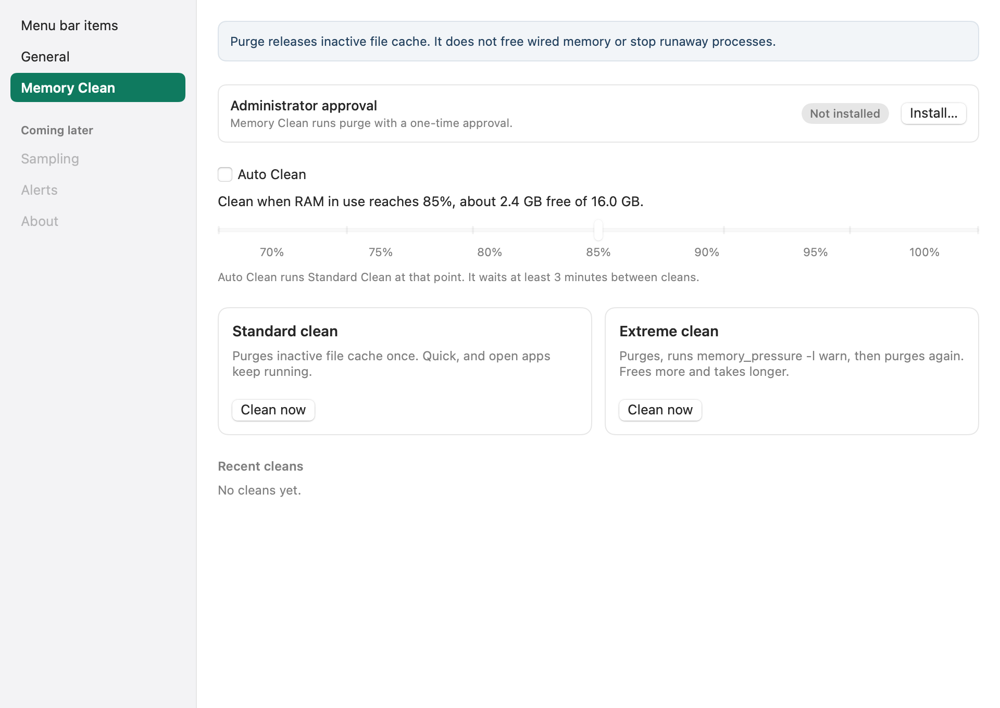

# StatusMonitor: a macOS menu bar system monitor

**StatusMonitor** is a free, native macOS menu bar app that shows your Mac's **CPU usage, RAM usage, network speed, disk I/O, GPU load, memory pressure, battery, and temperature** live in the menu bar. Choose which metrics appear and how they are formatted, and free inactive memory with one click.

It is written in pure Swift with AppKit and SwiftUI. It has **no third-party packages**, does not shell out to `top` or `ps`, and asks for **no privacy permissions**.

```
CPU 8%  ↓ 2.1 MB/s  ↑ 0.4 MB/s
```

| Light menu bar | Dark menu bar |
|---|---|
|  |  |

| Popover, light | Popover, dark |
|---|---|
|  |  |





## Features

- **Live menu bar readouts** for CPU, RAM, network, disk, GPU, memory pressure, battery, and temperature. Only metrics your Mac can provide are shown.
- **Popover with live details** in sections for CPU and memory, GPU, memory pressure, disk I/O, battery, network, and temperature and fans. Each section has its own toggles.
- **Speed test** on demand: press Run to measure download and upload in Mbit/s, latency and jitter. Nothing runs on its own. Packet loss is not measured yet.
- **Battery details** on request: charge, health, cycle count, power source, Low Power Mode, and time remaining.
- **Memory Clean** frees inactive memory using macOS's built-in `purge` command. It can run a Standard Clean or an Extreme Clean, and an **Auto Clean** can run it when used RAM passes a threshold you set.
- **Settings window** for the menu bar layout, General options, and Memory Clean.
- **Open at login** from the General settings.
- **Light and dark mode** support, following the system appearance.
- **Lightweight:** no Dock icon, refreshes every 2 seconds while the popover is open and every 5 seconds while it is closed.

## Install

StatusMonitor is built from source. You need macOS 13 or later and the Swift toolchain (Xcode or the Command Line Tools).

```sh
git clone https://github.com/nisarg96/StatusMonitor.git
cd StatusMonitor
./compile.sh                       # release build → build/StatusMonitor.app
open build/StatusMonitor.app       # launches into the menu bar
```

For a debug build, run `CONFIG=debug ./compile.sh`.

To quit, open the popover and choose **Quit** (⌘Q).

## Configuration

Click any menu bar item to open the popover. The main settings:

| Setting | Effect |
|---|---|
| CPU → Show in menu bar | Shows or hides the CPU/RAM segment |
| CPU → Display | `Percent` (`CPU 12%`) or `Used RAM (GB)` (`RAM 3.2 GB`) |
| Network → Show in menu bar | Shows or hides the ↓/↑ segment |
| Network → Include loopback | Counts `lo0` traffic (off by default) |
| Network → Interfaces | Comma-separated names such as `en0, utun3`. Blank counts all active interfaces |

Settings are saved in `UserDefaults` and restored at launch. No restart is needed.

## Memory Clean

Memory Clean frees inactive memory by running `/usr/sbin/purge`. Because that command needs administrator rights, the app asks you **once**, from the Memory Clean settings, to install a narrow sudoers rule. The rule allows only `/usr/sbin/purge` to run without a password. The app never asks for your password on its own. You can remove the rule at any time from the same settings.

- **Standard Clean:** one purge.
- **Extreme Clean:** a purge, a memory-pressure step, then a second purge. Each step is measured.
- **Auto Clean:** runs a Standard Clean when used RAM stays at or above your threshold (85% by default) for 30 seconds. It re-arms once RAM drops 5 points below the threshold. A clean that frees little makes the next wait longer, up to 30 minutes. After three failed cleans in a row, Auto Clean pauses. Its state is kept in memory, so it resets when the app restarts.
- Each clean is logged with the memory it freed.

## Permissions and privacy

- StatusMonitor requests **no** Accessibility, Screen Recording, Location, or other privacy permissions.
- Metrics come from `host_statistics(64)`, `getifaddrs`, IOKit, and the System Management Controller, all read locally. The speed test is the only feature that makes a network request.
- Nothing leaves the Mac unless you press **Run speed test**.
- When you press Run, the app contacts `speed.cloudflare.com`. It also sends small test requests to the same host. Packet loss is not measured yet.
- Cloudflare receives your IP address, the time, and the amount of traffic. Cloudflare's privacy policy applies to that data.
- The payloads are random bytes. The app does not upload your results or any identifiers.
- Speed-test traffic counts toward the network readout and the daily traffic total, because the system counters cannot tell it apart.
- The app never starts a test on its own.
- The only privileged action is the optional Memory Clean rule described above.

## Diagnostics

Print the same text the menu bar shows, every 2 seconds, without opening the GUI. Useful for comparing readings with Activity Monitor:

```sh
build/StatusMonitor.app/Contents/MacOS/StatusMonitor --dump-samples 10
```

Run one speed test and print the result. It contacts Cloudflare, as described under Permissions and privacy:

```sh
build/StatusMonitor.app/Contents/MacOS/StatusMonitor --speed-test
```

Re-render the README screenshots offscreen, without opening the status item or any window:

```sh
build/StatusMonitor.app/Contents/MacOS/StatusMonitor --snapshot docs/images
```

## Frequently asked questions

**Does it work on Apple Silicon and Intel Macs?**
Yes. It runs on both. GPU and temperature readings depend on what your Mac exposes, so those items appear only when they are available.

**Does it use a lot of CPU or battery?**
It samples at a low rate and only reads counters, so the impact is small. The refresh rate slows down while the popover is closed.

**Why does a menu bar item sometimes not appear?**
StatusMonitor never shows an item your Mac cannot measure, and it never displays placeholder values such as "N/A" or "0".

**Is it safe to clear memory with Memory Clean?**
It runs the standard macOS `purge` command, which releases inactive file-backed memory. It does not delete files or close apps.

## Development

```sh
swift test          # unit tests (no live system access)
./lint.sh           # SwiftLint, using the project configuration
```

The architecture follows clean architecture with MVVM. Dependencies point inward: `Domain` and `Application` know nothing about AppKit, SwiftUI, Mach, or IOKit. The layer rules, conventions, and known limitations are listed in [LIMITATIONS.md](docs/LIMITATIONS.md) and the project's contributor notes.

```
Sources/StatusMonitorCore/    Domain, Application, Presentation (view models), Infrastructure (adapters)
Sources/StatusMonitor/        App, CLI, and UI (AppKit status item and SwiftUI views)
Tests/StatusMonitorCoreTests/ Swift Testing suites, mirroring the Sources layout
Support/Info.plist            bundle metadata (LSUIElement = true, no Dock icon)
compile.sh                    build, bundle, and ad-hoc codesign
lint.sh                       SwiftLint runner
```

## Keywords

macOS menu bar app · system monitor · CPU usage · RAM usage · memory usage · network speed monitor · disk I/O monitor · GPU usage · battery monitor · temperature monitor · free up RAM · purge memory · menu bar status · Swift · SwiftUI · AppKit

## Copyright

Copyright © 2026 Nisarg Shah.

StatusMonitor is released under the [MIT License](LICENSE). You are free to use, copy, modify, merge, publish, distribute, and sell it, provided the copyright notice and license text are kept. The software comes with no warranty.
